# SPIFFE/SPIRE on OpenShift 4.20 - Architecture Playbook

Status: research notes, no code to deploy. YAML and shell lines are examples only.
Confidence: items marked (VERIFY) must be checked against the 4.20 docs before you build.

## 1. Short answer

- SPIFFE/SPIRE does not issue Kubernetes service account (SA) tokens.
  SPIRE issues SVIDs: X.509-SVID (certificate) or JWT-SVID (signed JWT).
- For use case 1 (app inside OpenShift, short-lived token): the built-in
  bound SA token (projected volume, TokenRequest API) is the simplest answer.
  Use SPIRE when you also need workload-to-workload identity (mTLS) or
  an identity that works outside the cluster.
- For use case 2 (app outside OpenShift calls the OpenShift API): you need
  a trust link between the outside identity and the API server.
  Two good patterns:
  - A. Direct: the API server trusts an OIDC issuer (external OIDC).
  - B. Broker: a small service checks the outside identity and returns
    a short-lived SA token (TokenRequest).
- OpenShift 4.20 ships SPIRE as an operator:
  "Zero Trust Workload Identity Manager" (VERIFY: GA status and exact name in 4.20).

## 2. SPIFFE/SPIRE in five lines

| Term | Meaning |
|------|---------|
| Trust domain | Root of trust, for example `apps.example.com`. One SPIRE server owns it. |
| SPIFFE ID | Workload name, for example `spiffe://apps.example.com/ns/demo/sa/web`. |
| SVID | Proof of that ID: X.509 certificate or JWT. Short life (default about 1 hour). |
| Node attestation | SPIRE agent proves the node is real (k8s_psat on OpenShift). |
| Workload attestation | Agent checks pod facts (namespace, SA, labels) before it gives an SVID. |

## 3. Target architecture on OpenShift 4.20

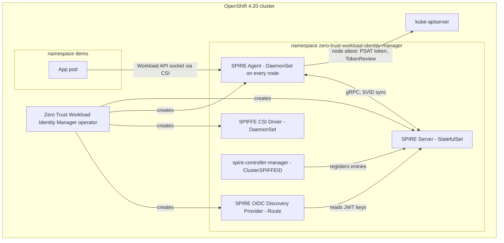

Custom resources used by the operator (VERIFY names):
`ZeroTrustWorkloadIdentityManager`, `SpireServer`, `SpireAgent`,
`SpiffeCSIDriver`, `SpireOIDCDiscoveryProvider`. Registration uses `ClusterSPIFFEID`.

Example: register all pods that carry a label.

```yaml
apiVersion: spire.spiffe.io/v1alpha1
kind: ClusterSPIFFEID
metadata:
  name: demo-web
spec:
  spiffeIDTemplate: "spiffe://apps.example.com/ns/{{ .PodMeta.Namespace }}/sa/{{ .PodSpec.ServiceAccountName }}"
  podSelector:
    matchLabels: { app: web }
  namespaceSelector:
    matchLabels: { kubernetes.io/metadata.name: demo }
```

Example: mount the Workload API socket in the app pod.

```yaml
volumes:
- name: spiffe-workload-api
  csi:
    driver: csi.spiffe.io
    readOnly: true
containers:
- name: web
  volumeMounts:
  - { name: spiffe-workload-api, mountPath: /spiffe-workload-api, readOnly: true }
  env:
  - { name: SPIFFE_ENDPOINT_SOCKET, value: unix:///spiffe-workload-api/spire-agent.sock }
```

OpenShift notes:
- SCC: the agent and CSI driver need host paths and privileged access. The operator sets this. App pods stay `restricted-v2`.
- The SPIRE server needs persistent storage (SQL datastore). Plan backup and HA (VERIFY supported HA in 4.20).
- Publish the OIDC discovery endpoint with a Route only if outside parties must verify JWT-SVIDs.

## 4. Use case 1 - App inside OpenShift, token with limited life

### 4.1 Option A: bound SA token (platform native)

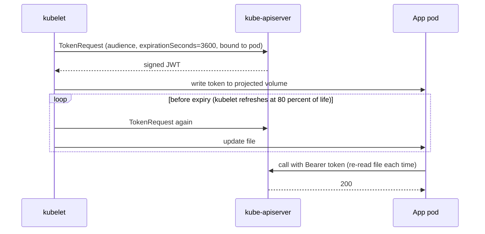

Example:

```yaml
volumes:
- name: api-token
  projected:
    sources:
    - serviceAccountToken:
        path: token
        audience: https://kubernetes.default.svc
        expirationSeconds: 3600   # minimum 600
```

Notes:
- Token is bound to the pod. The API server rejects it when the pod is deleted.
- The default token in every pod is already a bound, expiring token (about 1 hour, kubelet renews it).
- Long-lived SA secrets are not created automatically any more. Do not create them.

### 4.2 Option B: SPIRE JWT-SVID

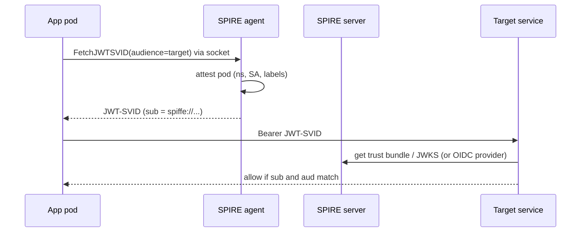

Important: the OpenShift API does not accept a JWT-SVID by default.
Use Option B for calls to your own services or other SPIFFE-aware services.
To call the OpenShift API with it, you need Section 5 pattern A or B.

### 4.3 Advantages and disadvantages

| Topic | A: bound SA token | B: SPIRE SVID |
|-------|-------------------|---------------|
| Setup effort | None, built in | Operator, storage, registration entries |
| Accepted by OpenShift API | Yes | No, needs extra trust setup |
| Identity scope | Cluster only | Across clusters, VMs, clouds (federation) |
| mTLS between workloads | No | Yes (X.509-SVID, auto rotation) |
| Rotation | kubelet, file reread needed | Workload API stream, library handles it |
| Revocation | Pod delete or SA delete | Delete entry, wait for TTL |
| Short life | Min 10 min | Can be minutes (server config) |
| Blast radius if stolen | Valid until expiry, bound to audience | Same, plus SPIRE server is a new critical asset |
| Operations cost | Low | Medium: upgrades, backups, HA, monitoring |
| Audit | Kubernetes audit log | SPIRE logs plus the audit log of the target |

Rule of thumb: only OpenShift API access -> bound SA token.
mTLS, multi-cluster, or one identity across platforms -> add SPIRE.

## 5. Use case 2 - App outside OpenShift calls the OpenShift API

Core problem: "secret zero". The outside app needs a first credential.
Goal: replace a stored static token by an identity the platform proves at run time.

### 5.1 Pattern A - Direct trust: API server accepts OIDC tokens

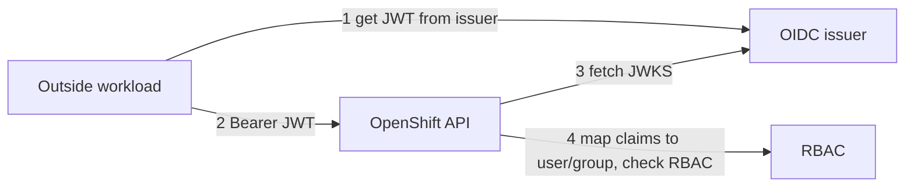

Issuer choices: GitHub Actions OIDC, SPIRE OIDC Discovery Provider, Keycloak.

OpenShift 4.20 side (VERIFY: external OIDC support level for standalone clusters):

```yaml
apiVersion: config.openshift.io/v1
kind: Authentication
metadata: { name: cluster }
spec:
  type: OIDC
  oidcProviders:
  - name: gha
    issuer:
      issuerURL: https://token.actions.githubusercontent.com
      audiences: [ "https://api.ocp.example.com" ]
    claimMappings:
      username: { claim: sub, prefixPolicy: Prefix, prefix: { prefixString: "gha:" } }
    claimValidationRules:
    - type: RequiredClaim
      requiredClaim: { claim: repository_owner, requiredValue: my-org }
```

Then bind RBAC to the mapped user:

```yaml
kind: RoleBinding
subjects:
- { kind: User, name: "gha:repo:my-org/my-repo:ref:refs/heads/main" }
roleRef: { kind: ClusterRole, name: edit }
```

Big warning: in OpenShift, enabling `type: OIDC` replaces the built-in OAuth server.
Users of `oc login` with HTPasswd or LDAP stop working. Plan this as a cluster-level decision.
Option to reduce risk: a webhook token authenticator (VERIFY support) or pattern B.

### 5.2 Pattern B - Broker: exchange outside identity for a short-lived SA token

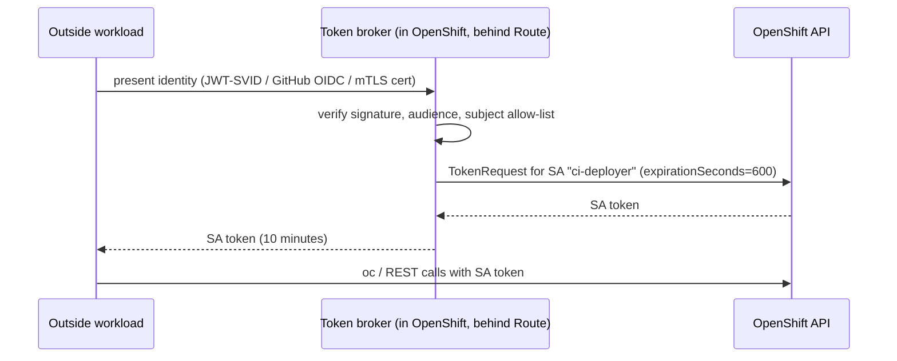

Pros: keeps OAuth server. SA + RBAC stay the permission model. Easy audit in one place.
Cons: you own the broker. It is a high-value target. Keep it small, with its own SA
that has only `create` on `serviceaccounts/token` for named SAs.

Broker RBAC example:

```yaml
kind: Role
rules:
- apiGroups: [""]
  resources: ["serviceaccounts/token"]
  resourceNames: ["ci-deployer"]
  verbs: ["create"]
```

Existing products can play the broker role: Keycloak (Red Hat build of Keycloak)
with token exchange, or Vault/OpenBao Kubernetes secrets engine
(it creates short-lived SA tokens after OIDC/JWT login).

### 5.3 The three client types

#### (a) GitHub Actions

GitHub already is an OIDC issuer. SPIRE is not needed here.

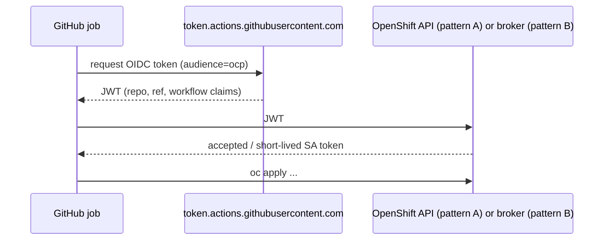

Example workflow (pattern B):

```yaml
permissions: { id-token: write, contents: read }
steps:
- run: |
    JWT=$(curl -sH "Authorization: bearer $ACTIONS_ID_TOKEN_REQUEST_TOKEN" \
      "$ACTIONS_ID_TOKEN_REQUEST_URL&audience=ocp-broker" | jq -r .value)
    TOKEN=$(curl -s -H "Authorization: Bearer $JWT" https://broker.apps.example.com/token | jq -r .token)
    oc login --token="$TOKEN" --server=https://api.ocp.example.com:6443
```

Constraints: the cluster API or broker must be reachable from GitHub.
Hosted runners use public IP ranges. Use self-hosted runners for private clusters.
Always pin claims: `repository`, `ref`, `environment`. Never trust only `aud`.

#### (b) Completely standalone application (VM, bare metal, other cloud)

Run a SPIRE agent on the host. It attests to the SPIRE server in OpenShift
(the server must be exposed by a Route/passthrough or LoadBalancer; VERIFY).
Alternative: a separate "nested" SPIRE server on the VM side.

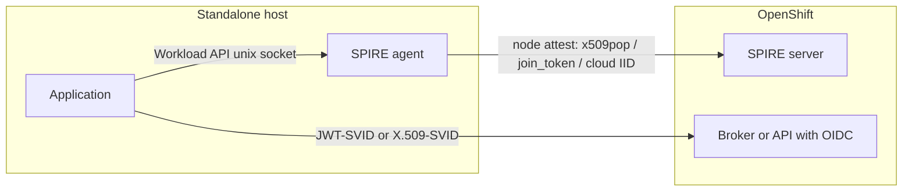

Workload attestation: `unix` attestor (uid, path, sha256 of binary).
Example registration:

```bash
spire-server entry create \
  -parentID spiffe://apps.example.com/spire/agent/x509pop/vm01 \
  -spiffeID spiffe://apps.example.com/vm/billing-sync \
  -selector unix:uid:1001
```

The app uses an SDK (go-spiffe, java-spiffe, py-spiffe) and gets a JWT-SVID with
audience `ocp-broker`. Pattern A also works if the SPIRE OIDC provider is the trusted issuer.

#### (c) Shell script

No SDK. Use the agent CLI on the same host.

```bash
JWT=$(spire-agent api fetch jwt -audience ocp-broker \
        -socketPath /run/spire/sockets/agent.sock -output json | jq -r '.[0].svids[0].svid')
TOKEN=$(curl -s -H "Authorization: Bearer $JWT" https://broker.apps.example.com/token | jq -r .token)
oc --token="$TOKEN" --server=https://api.ocp.example.com:6443 get pods -n demo
```

Pattern A variant: skip the broker, call `oc --token="$JWT"` directly.
Selector for the script: `unix:uid:<user>`. Do not use `unix:path` for the script:
the caller of the Workload API is the `spire-agent` CLI process, not the script.
Its path is `/usr/bin/spire-agent`. One Unix user for each identity is the real boundary.
Warning: any process with the same uid gets the same identity. Use a dedicated user.

## 6. Decision matrix

| Client | Simple and good | Strong and portable |
|--------|-----------------|---------------------|
| Pod in cluster | Bound SA token | SPIRE SVID + mTLS |
| GitHub Actions | GitHub OIDC -> broker (B) | GitHub OIDC -> external OIDC (A) |
| Standalone app | SPIRE agent + broker (B) | SPIRE OIDC + external OIDC (A) |
| Shell script | `spire-agent api fetch jwt` + broker | Same + dedicated Unix user |

## 7. Rollout plan

1. Phase 0 - Baseline: use bound SA tokens in all pods. Remove long-lived SA secrets.
2. Phase 1 - Install the operator in a test cluster. Set trust domain. Check SPIRE health.
3. Phase 2 - One pod gets an X.509-SVID. Prove mTLS between two pods.
4. Phase 3 - Build the broker (or choose Keycloak/Vault). Start with GitHub Actions, one repo, one SA, 10 minute tokens.
5. Phase 4 - Add the standalone host with SPIRE agent. Add the shell script case.
6. Phase 5 - Decide about external OIDC (pattern A) as a cluster-wide change.
7. Phase 6 - Production: HA, backup of SPIRE datastore, key rotation drill, alerts, audit dashboards.

## 8. Risks and open questions (VERIFY)

- Exact support level of Zero Trust Workload Identity Manager in 4.20 (GA or Tech Preview).
- External OIDC on standalone OpenShift 4.20: support level and impact on OAuth server.
- Exposing the SPIRE server to outside agents: supported route/ingress method.
- SPIRE HA and datastore support matrix for the operator.
- Trust domain naming and federation plan if you run more than one cluster.
- Clock skew between outside hosts and SPIRE: JWT checks fail when skew is large.
- Compromise plan: how to cut one identity fast (delete entry, change broker allow-list, short TTL).

## 9. Sources to check first

- Red Hat docs: OpenShift 4.20 "Zero Trust Workload Identity Manager"
- Red Hat docs: OpenShift 4.20 "Authentication and authorization" (external OIDC, bound SA tokens)
- spiffe.io/docs (concepts, Workload API, JWT-SVID spec)
- spiffe.io/docs/latest/deploying/registering/ (registration entries)
- Kubernetes docs: ServiceAccount token projection, TokenRequest API
- GitHub docs: "About security hardening with OpenID Connect"

## 10. Worked case: a few sandbox VMs, scripts started by cron

Goal: cron on each VM runs a script. The script calls the OpenShift API.
No static token on disk.

### 10.1 Architecture

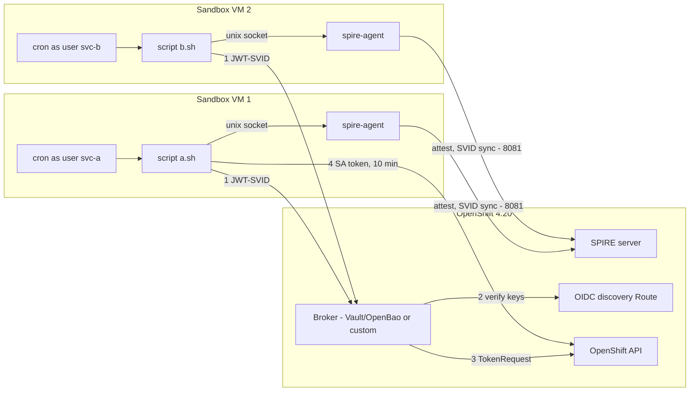

Network rules (VM to OpenShift): SPIRE server port, broker Route (443), API (6443).
Broker to OpenShift: SPIRE OIDC discovery Route.

### 10.2 One identity for each script

| Item | VM 1 | VM 2 |
|------|------|------|
| Unix user | svc-a | svc-b |
| SPIFFE ID | spiffe://apps.example.com/sandbox/vm1/a | spiffe://apps.example.com/sandbox/vm2/b |
| Selector | unix:uid of svc-a | unix:uid of svc-b |
| OpenShift SA | sa-a (Role: only what a.sh needs) | sa-b |
| Broker rule | sub = ID above, aud = ocp-broker -> sa-a | same for sa-b |

Rule: the selector is the Unix uid. The caller seen by the agent is the
`spire-agent` CLI, so `unix:path` of the script does not work.
Do not let one user run two different scripts if they need different rights.

### 10.3 Cron entry and script

```cron
# crontab -u svc-a -e
*/15 * * * * /opt/scripts/a.sh >> /var/log/svc-a/a.log 2>&1
```

```bash
#!/usr/bin/env bash
# /opt/scripts/a.sh - owner root, mode 0755, so svc-a cannot edit it
set -euo pipefail
export PATH=/usr/local/bin:/usr/bin:/bin           # cron has a small PATH
SOCK=/run/spire/sockets/agent.sock

JWT=$(spire-agent api fetch jwt -audience ocp-broker -socketPath "$SOCK" -output json \
      | jq -er '.[0].svids[0].svid')
TOKEN=$(curl -fsS --max-time 20 -H "Authorization: Bearer $JWT" \
      https://broker.apps.example.com/token | jq -er .token)

oc --token="$TOKEN" --server=https://api.ocp.example.com:6443 -n demo get pods
```

Socket permission: the agent socket must be readable by svc-a and svc-b
(for example group `spire`, mode 0660). The agent still checks the uid of the caller.

### 10.4 Setup order

1. OpenShift: create SA and Role for each script. Install the operator.
2. Expose the SPIRE server, the OIDC discovery Route, and the broker.
3. Build or configure the broker (rule for each SPIFFE ID).
4. Each VM: create users, install `spire-agent` (systemd, `Restart=always`).
5. Each VM: onboard the agent (join token, one per VM).
6. SPIRE server: create one entry for each script identity.
7. Test by hand as the user: `sudo -u svc-a /opt/scripts/a.sh`. Then add cron.

### 10.5 Operations

- Agent restart is safe: it keeps its node SVID on disk (KeyManager disk).
  If the VM is off longer than the node SVID life, it needs a new join token.
- Cron failures are silent. Send the log to a file, and alert on "no success in 2 runs".
- Monitor: agent health (`spire-agent healthcheck`), SVID expiry, broker 4xx count.
- Clean up: delete the entry and the broker rule when you remove a VM.

### 10.6 Is SPIRE worth it for two sandbox VMs?

| Option | Effort | Secret on VM | Verdict |
|--------|--------|--------------|---------|
| Static SA token in a file | Very low | Yes, long life | Fast, but a leak is valid until you rotate it. Acceptable only for a throw-away sandbox. |
| SPIRE agent + broker (this section) | Medium to high | Only the one-time join token | Right when you want to learn the pattern or expect more VMs. |
| Cloud/hypervisor identity + broker | Medium | None | Best if the sandbox is on AWS/Azure/GCP: use `aws_iid`, `azure_msi`, `gcp_iit`. |

The cost is mostly the first build: server exposure, broker, entries.
Each extra VM or script then costs only a join token and an entry.

## 11. RBAC and identity mapping

SPIRE says WHO the workload is. It does not say what the workload may do.
There are three separate layers. Each has its own place.

| Layer | Question | Where you set it | Object |
|-------|----------|------------------|--------|
| 1. Identity | Who is this process? | SPIRE server | Registration entry (selector -> SPIFFE ID) |
| 2. Mapping | Which OpenShift identity does this SPIFFE ID get? | Broker (pattern B) or API server (pattern A) | Broker role, or `Authentication` CR |
| 3. Permission | What may that OpenShift identity do? | OpenShift | Role, RoleBinding |

### 11.1 Pattern B (broker): mapping is in the broker

The OpenShift API never sees the SPIFFE ID. It only sees an SA token.
So layer 3 is normal Kubernetes RBAC on a ServiceAccount.


Layer 3 (OpenShift):
```yaml
apiVersion: v1
kind: ServiceAccount
metadata: { name: sa-a, namespace: demo }
---
kind: Role
metadata: { name: a-role, namespace: demo }
rules:
- apiGroups: [""]
  resources: ["pods"]
  verbs: ["get", "list"]
---
kind: RoleBinding
metadata: { name: a-rb, namespace: demo }
subjects: [{ kind: ServiceAccount, name: sa-a, namespace: demo }]
roleRef: { kind: Role, name: a-role, apiGroup: rbac.authorization.k8s.io }
```

Layer 2 (broker), example with Vault/OpenBao (VERIFY exact options):
```bash
# trust the SPIRE issuer
vault write auth/jwt/config oidc_discovery_url=https://oidc-discovery.apps.example.com

# SPIFFE ID -> Vault policy
vault write auth/jwt/role/sandbox-vm1-a \
  role_type=jwt user_claim=sub \
  bound_audiences=ocp-broker \
  bound_subject=spiffe://apps.example.com/sandbox/vm1/a \
  token_policies=ocp-sa-a token_ttl=5m

# policy ocp-sa-a allows only: kubernetes/creds/sa-a

# Vault role -> OpenShift SA
vault write kubernetes/roles/sa-a \
  allowed_kubernetes_namespaces=demo \
  service_account_name=sa-a \
  token_default_ttl=10m
```

Layer 2 (custom broker): a static table, for example in a ConfigMap:
```yaml
rules:
- sub: spiffe://apps.example.com/sandbox/vm1/a
  aud: ocp-broker
  serviceAccount: demo/sa-a
  ttl: 600
```
Rule: exact match on `sub`. No wildcards.

The broker also needs RBAC. Give it `create` on `serviceaccounts/token`
for the named SAs only (see section 5.2).

### 11.2 Pattern A (external OIDC): mapping is in the Authentication CR

The API server reads the JWT and builds a user name from claims.
Layer 3 binds to that user name.

```yaml
spec:
  type: OIDC
  oidcProviders:
  - name: spire
    issuer: { issuerURL: https://oidc-discovery.apps.example.com, audiences: [ocp-api] }
    claimMappings:
      username:
        claim: sub
        prefixPolicy: Prefix
        prefix: { prefixString: "spiffe:" }
```
Resulting user name: `spiffe:spiffe://apps.example.com/sandbox/vm1/a`
```yaml
kind: RoleBinding
subjects:
- { kind: User, name: "spiffe:spiffe://apps.example.com/sandbox/vm1/a", apiGroup: rbac.authorization.k8s.io }
roleRef: { kind: Role, name: a-role, apiGroup: rbac.authorization.k8s.io }
```
Limits:
- A JWT-SVID has only `sub`, `aud`, `exp`, `iat`. SPIRE does not add custom claims or groups (VERIFY).
  So you cannot map to groups. You need one RoleBinding for each SPIFFE ID.
- The prefix keeps SPIFFE users apart from human users. Always set it.

### 11.3 Which is better for you

| | Pattern B (broker) | Pattern A (OIDC) |
|---|---|---|
| Where mapping lives | Broker config | `Authentication` CR |
| RBAC subject | ServiceAccount | User with long name |
| Group mapping | Yes, SA can join groups | No |
| Audit log user | `system:serviceaccount:demo:sa-a` (readable) | `spiffe:spiffe://...` |
| Cluster-wide impact | None | Replaces built-in OAuth server |

### 11.4 Good practice

- One SPIFFE ID, one SA, one Role. No shared SAs.
- Use Role and RoleBinding in a namespace. Avoid ClusterRole unless you must.
- Name the entities the same way: `sandbox/vm1/a` -> `sa-a`. It makes reviews easy.
- Keep all three layers in Git: SPIRE entries (ClusterSPIFFEID or a script), broker rules, RBAC YAML.
- Test the limit: `oc auth can-i delete pods --as=system:serviceaccount:demo:sa-a -n demo` must say `no`.
- Review the three layers together when you add or remove a script. A deleted entry with a left-over broker rule is a hole.

## 12. Worked case: long-running Node.js app in a datacenter

Same trust chain as section 10. Two differences:
the app runs all the time, so token life cycle matters, and it can talk to the agent itself.

### 12.1 Architecture

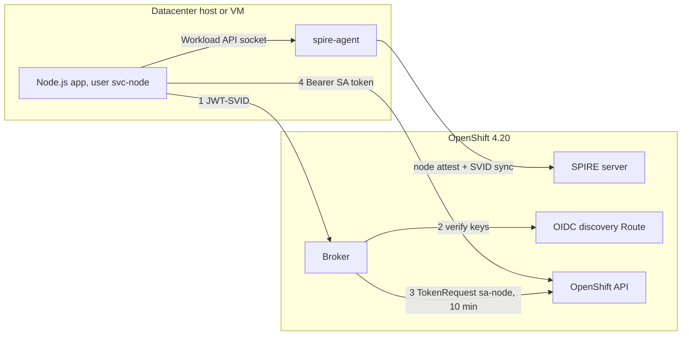

### 12.2 Token life cycle inside the app

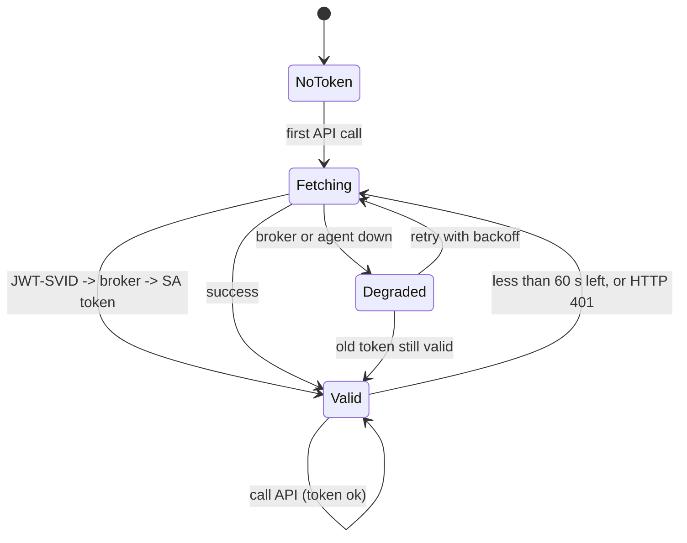

Rules:
- Keep the token in memory only. Never write it to disk or log it.
- Refresh before expiry (for example 60 s early). Also refresh once on HTTP 401.
- Allow only one refresh at a time (one shared promise), so 100 parallel calls do not make 100 broker requests.
- Backoff on failure. Keep using the old token until it expires.

### 12.3 Three ways to connect Node.js to the agent

| Way | How | Note |
|-----|-----|------|
| 1. kubeconfig exec plugin (least app code) | A small helper script does JWT -> broker and prints an `ExecCredential` JSON with `expirationTimestamp`. `@kubernetes/client-node` and `oc` call it again when needed. | The app has no token code. Refresh is automatic. |
| 2. Call the Workload API from Node | gRPC (`@grpc/grpc-js`) with the SPIFFE `workload.proto` over the Unix socket. | No mature official Node SDK, to my knowledge (VERIFY). More code to own. |
| 3. spiffe-helper | Sidecar process writes the JWT-SVID to a file and renews it. App reads the file. | Simple. The app must re-read the file on each call. |

My pick: way 1 for a standard client library, or way 3 if you use plain `fetch`.

Example for way 1 (the app side is only config):
```yaml
# kubeconfig
users:
- name: sa-node
  user:
    exec:
      apiVersion: client.authentication.k8s.io/v1
      command: /opt/node-app/bin/get-ocp-token
      interactiveMode: Never
```
```js
// app: no token handling
const kc = new KubeConfig(); kc.loadFromFile('/etc/node-app/kubeconfig');
const core = kc.makeApiClient(CoreV1Api);
```
Helper output (printed by `get-ocp-token`):
```json
{"apiVersion":"client.authentication.k8s.io/v1","kind":"ExecCredential",
 "status":{"token":"<SA token>","expirationTimestamp":"2026-01-01T10:10:00Z"}}
```
The helper can be the shell script from section 10. Keep it small and owned by root.

### 12.4 Identity (layer 1) for a Node.js process

Pick selectors that match how the app runs.

| Run mode | Selectors | Note |
|----------|-----------|------|
| systemd on a VM | `unix:uid:<svc-node>` | Add `unix:gid`. Dedicated user is the real boundary. |
| Docker container | `docker:label:app:payments`, `docker:image_id:...` | Needs the Docker socket for the agent. Good fit for containers. |
| Kubernetes in the datacenter (not OpenShift) | `k8s:ns:..`, `k8s:sa:..` | Agent uses `k8s_psat` against that cluster. |
| Calls Workload API itself (way 2) | `unix:path:/usr/bin/node` possible | This matches the node binary, not your script. Weak. |

### 12.5 Node attestation in a datacenter (layer 0)

No cloud identity exists, so choose one:

| Method | Secret on host | Fit |
|--------|----------------|-----|
| `join_token` | One-time token | Simple. Fine for a few hosts. Needs a human or tool for each new host. |
| `x509pop` | Host certificate from your internal PKI | Best for many hosts. Auto-issued by existing tooling (Ansible, Puppet, etc.). |
| `tpm_devid` or similar | None (hardware key) | Strongest, more work. It is not part of core SPIRE, so check it (VERIFY). |
| `ssh_pop` | Host SSH certificate | Good if you use SSH certificates already. |

### 12.6 Network and security checklist

- Firewall: datacenter -> SPIRE server port, broker (443), OpenShift API (6443).
  If you cannot open the SPIRE server port, use Layout 2 (own SPIRE server in the datacenter, with federation or nesting).
- Broker rule: exact `sub` of this app, one SA, one Role, TTL 10 minutes.
- App user cannot write the app code or the helper script.
- Egress proxy: set `NODE_EXTRA_CA_CERTS` if the OpenShift API uses a private CA.
- Observability: log token fetch success and failure (never the token). Alert on repeated failures.
- Time sync (NTP) on the host. JWT checks fail when skew is large.

### 12.7 Failure behavior

| Failure | Result | What to do |
|---------|--------|------------|
| Agent down | No new JWT-SVID. App uses the old token until expiry (max 10 min). | systemd `Restart=always`. Alert. |
| Broker down | Same as above | HA broker. Alert. |
| SPIRE server down | Agent keeps cached SVIDs until they expire, so JWT-SVID may still work for a while | HA server, backup |
| Entry deleted | New fetch fails. Existing token lives until expiry. | This is the revocation speed: at most one token TTL |
| 403 from API | RBAC too small | Fix Role, not the identity |

## 13. What is SPIRE for

SPIRE gives software workloads a verifiable identity without stored passwords or API keys.
It checks facts about the workload (node, namespace, SA, Unix user, container labels).
Then it issues a short-lived identity document (SVID) and renews it by itself.
Other services verify the SVID with a trust bundle. No shared secret is needed.

Uses: mTLS between services, login to Vault or a cloud without static keys,
one identity across VMs and clusters, federation, zero trust, service mesh identity.

SPIRE is not: a user login system, an authorisation system (RBAC does that),
or a secrets store. For one cluster with pods that only call the Kubernetes API,
bound SA tokens are enough.

## 14. What is an SVID

A SPIFFE ID is a name: `spiffe://<trust domain>/<path>`. It proves nothing alone.
An SVID is the SPIFFE ID plus a signature from the SPIRE server.

| | X.509-SVID | JWT-SVID |
|---|---|---|
| Format | Certificate, ID in the SAN URI | Signed JWT, ID in `sub` |
| Proof of ownership | Private key (mTLS) | Show the token |
| Use | mTLS between services | Bearer token to broker, Vault |
| If stolen | Useless without the key | Usable until expiry |
| Audience limit | No | Yes (`aud`) |

JWT-SVID claims are only `sub`, `aud`, `iat`, `exp`. No groups, no custom claims (VERIFY).

An SVID is not an OpenShift SA token. The SA token is signed by the OpenShift API server
and means "this is SA X". The SVID is signed by SPIRE and means "this is workload Y".
The broker converts the SVID into an SA token.

## 15. Component roles

| | spire-agent | SPIRE server | Broker |
|---|---|---|---|
| Part of SPIRE | Yes | Yes | No, you add it |
| Where | Every host, next to the app | Central, in OpenShift | Central, in OpenShift |
| Job | Attests local workloads, hands out SVIDs | Root of trust, signs SVIDs | Trades JWT-SVID for an SA token |
| Talks to | App (unix socket), server (mTLS) | Agents | Apps (HTTPS), OpenShift API |
| Knows OpenShift RBAC | No | No | Yes (SPIFFE ID to SA map) |
| OpenShift credential | None (outside cluster) | Own SA: TokenReview, read pods and nodes | Own SA: create `serviceaccounts/token` for named SAs |

Keep the SPIRE server and the broker separate. The SPIRE server is a root of trust.
It must not hold rights to create SA tokens.

The broker does not call the SPIRE server for each request.
It reads the public signing keys from the OIDC discovery Route and verifies signatures.

## 16. Agent placement

Run one agent on each host, next to the apps. Do not use a central agent.

- The agent identifies the caller from the kernel (pid, uid, container) over a Unix socket.
  A socket cannot cross hosts.
- The agent attests the node. It cannot attest other machines.
- Several apps on one host share one agent (one entry for each app, selector uid).
- Docker host: one agent, socket mounted into containers.
- Kubernetes or OpenShift: one agent for each node (DaemonSet), CSI driver mounts the socket.
- Install agents with automation (Ansible, Puppet, image), not by hand.
- Do not expose the agent socket over TCP. This breaks caller identification.

### 16.1 How the app authenticates to the agent

There is no credential. The kernel gives the agent the caller facts (SO_PEERCRED).
The agent matches them with registration entries. No match means PermissionDenied.
- Socket file permissions are the first gate. Selector match is the second gate.
- The Workload API needs the gRPC header `workload.spiffe.io: true`.
  SDKs and the `spire-agent api` CLI add it. Raw gRPC in Node must add it.
- Same Unix uid means same identity. Use a dedicated user for each identity.

### 16.2 Is the agent a bottleneck

| Concern | Reality |
|---------|---------|
| Throughput | Low risk. Ask once every 5 to 10 minutes, not for each API call. Agent caches SVIDs (VERIFY JWT cache). |
| Server load | Agents sync in batches. |
| Availability | Real risk: one agent for each host. SA token life (10 min) covers short outages. |

Mitigation: cache the token in the app, systemd `Restart=always`, health check,
alert on failure, exponential backoff with jitter, prefer `x509pop` so the agent can re-attest alone.

## 17. How the agent authenticates

The agent outside OpenShift does not authenticate to OpenShift. It authenticates to the SPIRE server.

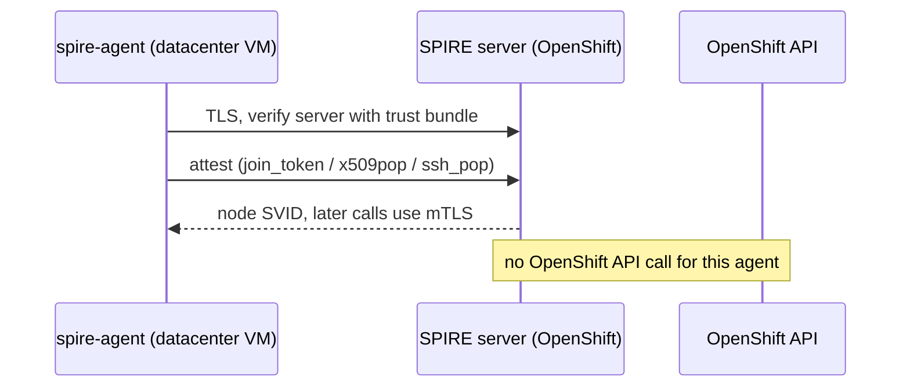

Inside OpenShift the agent uses `k8s_psat`: it sends its projected SA token to the
SPIRE server. The server calls TokenReview on the OpenShift API to check it.

| From | To | Authentication |
|------|----|----------------|
| Agent on VM | SPIRE server | Trust bundle + join_token / x509pop / ssh_pop, then node SVID mTLS |
| Agent in OpenShift | SPIRE server | Projected SA token (`k8s_psat`), TokenReview |
| SPIRE server | OpenShift API | Own SA |
| App | Agent | Unix socket, kernel caller check |
| App | Broker | JWT-SVID |
| Broker | OpenShift API | Own SA, `serviceaccounts/token` create only |
| App | OpenShift API | Short-lived SA token from broker |

Secrets on the VM for the agent: the trust bundle (public, but must not be changed)
and the join token (single use) or the host certificate and key (protect like any private key).

## 18. Glossary

| Term | Meaning |
|------|---------|
| Trust domain | Root of trust and name space of one SPIRE deployment |
| SPIFFE ID | Name of a workload, URI form |
| SVID | Signed proof of a SPIFFE ID (X.509 or JWT) |
| Trust bundle | Public keys used to verify SVIDs |
| Node attestation | Agent proves the host is real |
| Workload attestation | Agent checks facts about a local process |
| Selector | A fact used in a registration entry (for example `unix:uid:1001`) |
| Registration entry | Maps selectors to a SPIFFE ID |
| Workload API | Local gRPC API (Unix socket) that gives SVIDs to workloads |
| Broker | Service that trades an SVID for an OpenShift SA token |
| SA token | OpenShift service account token, signed by the API server |

## 19. Worked case: GitLab pipelines, one identity for each repository

### 19.1 Key point: SPIRE is not needed

GitLab CI is already an OIDC issuer (same idea as GitHub Actions, section 5.3(a)).
Each job can request a signed JWT (an ID token) that names the project, branch, and environment.
The identity for each repository comes from these claims, not from a SPIRE agent.

A SPIRE agent on the runner would identify the runner host, not the repository.
All jobs on that runner would look the same. This is weaker. Use GitLab OIDC.

### 19.2 Flow (broker pattern)

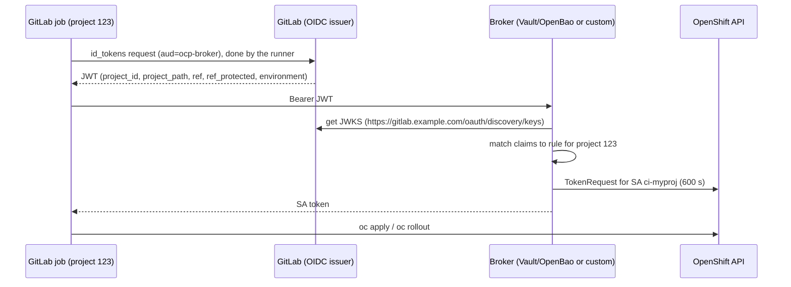

### 19.3 Example JWT claims (decoded, main ones)

```json
{
  "iss": "https://gitlab.example.com",
  "aud": "ocp-broker",
  "sub": "project_path:mygroup/myproj:ref_type:branch:ref:main",
  "project_id": "123",
  "project_path": "mygroup/myproj",
  "namespace_path": "mygroup",
  "ref": "main",
  "ref_protected": "true",
  "environment": "production",
  "pipeline_source": "push"
}
```
Claim values are strings. Check the claim list for your GitLab version (VERIFY).

### 19.4 Pipeline example

```yaml
deploy-prod:
  stage: deploy
  environment: production
  id_tokens:
    OCP_JWT:
      aud: ocp-broker
  script:
    - TOKEN=$(curl -fsS -H "Authorization: Bearer $OCP_JWT" https://broker.apps.example.com/token | jq -er .token)
    - oc login --token="$TOKEN" --server=https://api.ocp.example.com:6443
    - oc -n myproj-prod rollout restart deploy/web
  rules:
    - if: $CI_COMMIT_REF_PROTECTED == "true"
```

The runner must reach the broker (or the API). Use a self-hosted runner for a private cluster.
The runner must have `oc` and `jq`.

### 19.5 Mapping: one repository to one identity

Layers, as in section 11:

| Layer | Question | Where |
|-------|----------|-------|
| 1. Identity | Which repo and branch is this? | GitLab (signs the JWT) |
| 2. Mapping | Which SA does this repo get? | Broker rule (or `Authentication` CR in pattern A) |
| 3. Permission | What may the SA do? | OpenShift Role and RoleBinding |

Match on `project_id`, not on `project_path`.
A project can be renamed or deleted, and someone can then create a new project with the old path.
`project_id` does not change. Show the path in a comment for people to read.

Broker rule example (custom broker, in Git):
```yaml
rules:
- match:
    project_id: "123"          # mygroup/myproj
    ref_protected: "true"
    environment: production
  serviceAccount: myproj-prod/ci-myproj
  ttl: 600
- match:
    project_id: "123"
    environment: staging
  serviceAccount: myproj-stage/ci-myproj
  ttl: 600
```

Vault/OpenBao example (VERIFY options):
```bash
vault write auth/gitlab/config oidc_discovery_url=https://gitlab.example.com bound_issuer=https://gitlab.example.com
vault write auth/gitlab/role/myproj-prod \
  role_type=jwt user_claim=project_id \
  bound_audiences=ocp-broker \
  bound_claims_type=string \
  bound_claims='{"project_id":"123","ref_protected":"true","environment":"production"}' \
  token_policies=ocp-myproj-prod token_ttl=5m
vault write kubernetes/roles/myproj-prod \
  allowed_kubernetes_namespaces=myproj-prod \
  service_account_name=ci-myproj token_default_ttl=10m
```

OpenShift RBAC (layer 3), for each project and environment:
```yaml
apiVersion: v1
kind: ServiceAccount
metadata: { name: ci-myproj, namespace: myproj-prod }
---
kind: Role
metadata: { name: ci-deployer, namespace: myproj-prod }
rules:
- apiGroups: ["apps"]
  resources: ["deployments"]
  verbs: ["get", "patch", "update"]
---
kind: RoleBinding
metadata: { name: ci-deployer, namespace: myproj-prod }
subjects: [{ kind: ServiceAccount, name: ci-myproj, namespace: myproj-prod }]
roleRef: { kind: Role, name: ci-deployer, apiGroup: rbac.authorization.k8s.io }
```

### 19.6 Pattern A variant (no broker)

OpenShift trusts the GitLab issuer directly. Map the user name from a stable claim.

```yaml
spec:
  type: OIDC
  oidcProviders:
  - name: gitlab
    issuer: { issuerURL: https://gitlab.example.com, audiences: [ocp-api] }
    claimMappings:
      username:
        claim: project_id
        prefixPolicy: Prefix
        prefix: { prefixString: "gitlab:" }
    claimValidationRules:
    - type: RequiredClaim
      requiredClaim: { claim: ref_protected, requiredValue: "true" }
```
Then bind `User gitlab:123` in the right namespace.
Same warning as before: external OIDC replaces the built-in OAuth server.
Also, GitLab must be reachable from the API server to fetch the keys (VERIFY).

### 19.7 How to manage many repositories

Do not edit the broker by hand for each repository. Use a self-service model in Git (GitOps).

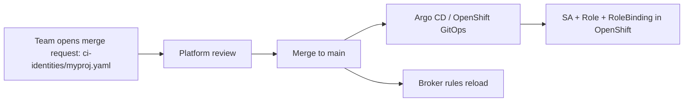

One small file for each project, for example:
```yaml
# ci-identities/myproj.yaml
gitlabProjectId: "123"
gitlabProjectPath: mygroup/myproj   # for humans
environments:
  - name: staging
    namespace: myproj-stage
    protectedRefOnly: false
    role: ci-deployer
  - name: production
    namespace: myproj-prod
    protectedRefOnly: true
    role: ci-deployer
```
A template (Helm or Kustomize) creates the SA, Role, RoleBinding, and the broker rule from this file.

Good rules for scale:
- One project, one SA for each environment. No shared SAs across projects.
- Production identity only for `ref_protected=true` and the right `environment` claim.
- Put approval of production access under a protected GitLab environment and a code owner on the identity repo.
- Use a small set of standard Roles (`ci-deployer`, `ci-readonly`). Avoid custom Roles for each project.
- Group-level access (all projects in `mygroup`) is possible with the `namespace_path` claim.
  Use it only for read-only rights. Avoid it for deploy rights.
- Remove the file when a repository is archived. Review orphan identities each quarter.
- Test the limits: `oc auth can-i delete pods --as=system:serviceaccount:myproj-prod:ci-myproj -n myproj-prod` must say `no`.

### 19.8 Risks

| Risk | Control |
|------|---------|
| Any branch or fork pipeline gets production access | Require `ref_protected` and the `environment` claim. Protect branches and environments in GitLab. |
| A developer writes a pipeline that requests a token with the right claims | Only allowed branches get the claims. Use protected branches and approval for `.gitlab-ci.yml` changes. |
| Project renamed or recreated | Match on `project_id`. |
| Token leaks in job logs | Mask variables. Do not `set -x`. Tokens live about 10 minutes. |
| GitLab outage or key rotation | Broker caches JWKS and refreshes it. Alert on failures. |
| Shared runner can reach internal broker | Use dedicated runners for deploy jobs. Restrict by network. |
| Broker is a high-value target | It holds `serviceaccounts/token create` only for named SAs. HA, audit logs. |

### 19.9 Where SPIRE could still help

- Inside the broker side: SPIRE can secure the broker's own connections (mTLS) in OpenShift.
- If the runners are your own VMs and you also want to prove the runner host is trusted.
  Use this as an extra check, together with the GitLab claims. It cannot replace them.
- For all other parts of this case, GitLab OIDC alone does the job.

## 20. OpenShift setup for the GitLab case (checklist)

Assumes pattern B (broker). Pattern A is in 20.9.

### 20.1 Overview of what you create

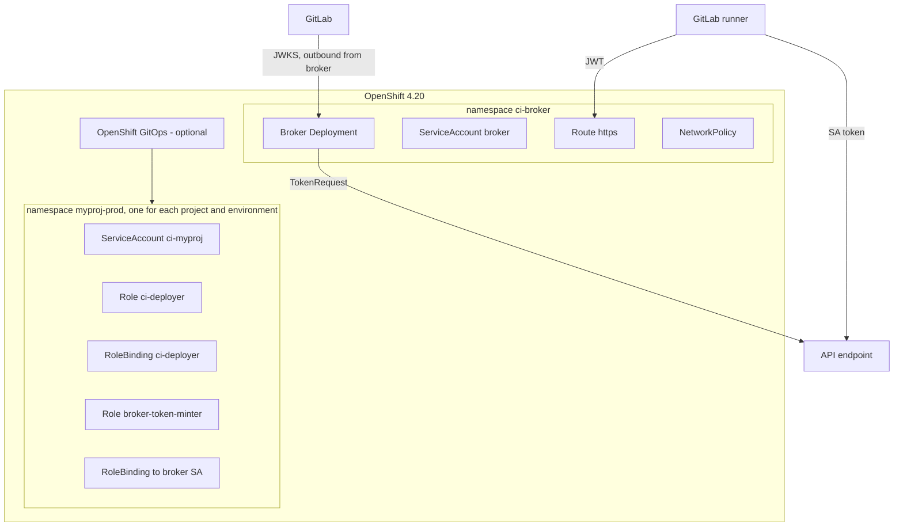

### 20.2 Checklist

| # | Item | Where | Note |
|---|------|-------|------|
| 1 | Namespace `ci-broker` | Cluster | Own namespace, restricted access |
| 2 | Broker ServiceAccount | `ci-broker` | No cluster-admin. No broad rights. |
| 3 | Broker Deployment | `ci-broker` | 2 replicas, `restricted-v2` SCC, resource limits |
| 4 | Broker config (rules) | ConfigMap, from Git | SPIFFE-free: GitLab `project_id` to SA |
| 5 | Route (TLS) | `ci-broker` | Runners must reach it |
| 6 | NetworkPolicy | `ci-broker` | Ingress from router only. Egress to GitLab and the API only. |
| 7 | Trust for GitLab CA | ConfigMap | Needed when GitLab uses a private CA |
| 8 | For each project: namespace, SA, Role, RoleBinding | `myproj-*` | From the Git file (section 19.7) |
| 9 | For each target SA: token-minter Role + RoleBinding | `myproj-*` | Lets the broker create tokens for that SA only |
| 10 | API reachability and CA for runners | Network | Runner needs the API URL and the cluster CA |
| 11 | Monitoring and audit | Cluster | Alerts on broker errors, review audit log |
| 12 | GitOps (optional) | OpenShift GitOps operator | Creates item 8 and 9 from Git |

### 20.3 Broker identity and namespace-level rights

The broker must not have a ClusterRole that can mint tokens for any SA.
Give it a Role in each target namespace, limited to named SAs.

```yaml
apiVersion: v1
kind: Namespace
metadata: { name: ci-broker }
---
apiVersion: v1
kind: ServiceAccount
metadata: { name: broker, namespace: ci-broker }
---
# in each target namespace, for example myproj-prod
kind: Role
apiVersion: rbac.authorization.k8s.io/v1
metadata: { name: broker-token-minter, namespace: myproj-prod }
rules:
- apiGroups: [""]
  resources: ["serviceaccounts/token"]
  resourceNames: ["ci-myproj"]
  verbs: ["create"]
---
kind: RoleBinding
apiVersion: rbac.authorization.k8s.io/v1
metadata: { name: broker-token-minter, namespace: myproj-prod }
subjects: [{ kind: ServiceAccount, name: broker, namespace: ci-broker }]
roleRef: { kind: Role, name: broker-token-minter, apiGroup: rbac.authorization.k8s.io }
```

The broker has no other rights. It does not need `get` on secrets, pods, or the SA.

### 20.4 Broker Deployment, Route, NetworkPolicy

```yaml
apiVersion: apps/v1
kind: Deployment
metadata: { name: broker, namespace: ci-broker }
spec:
  replicas: 2
  selector: { matchLabels: { app: broker } }
  template:
    metadata: { labels: { app: broker } }
    spec:
      serviceAccountName: broker
      containers:
      - name: broker
        image: registry.example.com/platform/ci-broker:1.0
        ports: [{ containerPort: 8443 }]
        resources:
          requests: { cpu: 100m, memory: 128Mi }
          limits: { memory: 256Mi }
        volumeMounts:
        - { name: rules, mountPath: /etc/broker, readOnly: true }
        - { name: ca, mountPath: /etc/pki/ca-trust/extracted/pem, readOnly: true }
      volumes:
      - name: rules
        configMap: { name: broker-rules }
      - name: ca
        configMap:
          name: trusted-ca
          items: [{ key: ca-bundle.crt, path: tls-ca-bundle.pem }]
---
# empty ConfigMap that OpenShift fills with the cluster trusted CA bundle
apiVersion: v1
kind: ConfigMap
metadata:
  name: trusted-ca
  namespace: ci-broker
  labels: { config.openshift.io/inject-trusted-cabundle: "true" }
---
apiVersion: route.openshift.io/v1
kind: Route
metadata: { name: broker, namespace: ci-broker }
spec:
  host: broker.apps.example.com
  to: { kind: Service, name: broker }
  tls: { termination: reencrypt }
---
apiVersion: networking.k8s.io/v1
kind: NetworkPolicy
metadata: { name: broker, namespace: ci-broker }
spec:
  podSelector: { matchLabels: { app: broker } }
  policyTypes: [Ingress, Egress]
  ingress:
  - from:
    - namespaceSelector:
        matchLabels: { policy-group.network.openshift.io/ingress: "" }
  egress:
  - ports: [{ port: 443, protocol: TCP }, { port: 6443, protocol: TCP }]
  - ports: [{ port: 53, protocol: UDP }]
```
Tighten the egress rules to the GitLab and API addresses when you can (use an EgressFirewall or CIDR rules).
The broker image is custom. If you use Vault/OpenBao instead, replace items 3 and 4 with Vault.

### 20.5 Trust for a private GitLab CA

Two cases:
- Cluster-wide proxy or trust bundle: add the GitLab CA to `proxy/cluster` `spec.trustedCA`.
  The injected ConfigMap above then includes it.
- Only for the broker: mount a ConfigMap that holds the GitLab CA and point the broker to it.

### 20.6 Per-project objects (from the Git file)

For each project and environment, create:
1. Namespace `myproj-prod`.
2. ServiceAccount `ci-myproj`, Role `ci-deployer`, RoleBinding (see section 19.5).
3. Role and RoleBinding `broker-token-minter` (see 20.3).
4. A broker rule entry in the ConfigMap `broker-rules` (see section 19.5).
5. Optional: ResourceQuota and LimitRange, so a CI mistake cannot use the whole cluster.

Use OpenShift GitOps (Argo CD) with an ApplicationSet that reads `ci-identities/*.yaml`.
Without GitOps, use a CI job or a script that runs `oc apply`.

### 20.7 Network and access for the runner

- The runner reaches the API at `https://api.ocp.example.com:6443` and the broker Route on 443.
- The runner needs the cluster CA for `oc login --certificate-authority=...`.
  Store the CA file (public, not secret) in the runner image or in the repository.
- If the API is not routable from the runner network, use a self-hosted runner in a network that can reach it.

### 20.8 Observability

- Broker: log each decision (project_id, rule, SA, result). Never log the JWT or the SA token.
- Alert on: failed JWT checks, rules that do not match, token create errors, 5xx.
- OpenShift audit log: look for `serviceaccounts/token` create by the broker SA
  and for API calls by `system:serviceaccount:myproj-prod:ci-myproj`.
- Dashboard: tokens issued for each project and per day.

### 20.9 Pattern A: setup if you choose no broker

| # | Item | Note |
|---|------|------|
| 1 | ConfigMap with GitLab CA in `openshift-config` | Only if GitLab uses a private CA. Referenced by `issuerCertificateAuthority`. |
| 2 | `Authentication` CR `type: OIDC` with the GitLab provider | See section 19.6. VERIFY 4.20 support level. |
| 3 | Wait for the kube-apiserver rollout | The cluster rolls out new API server config. |
| 4 | RoleBinding for each `gitlab:<project_id>` user | One for each project and environment. |
| 5 | Plan for human login | The built-in OAuth server is replaced. Plan for `oc login`, the console, and `kubeadmin`. |
| 6 | GitLab reachable from the API server | It fetches the keys. |

This is a cluster-wide change. Try it in a test cluster first.

### 20.10 Order of work

1. Create `ci-broker` namespace, broker SA, and a first test project (one SA, one Role).
2. Deploy the broker with one rule. Test with a manual JWT from a test job.
3. Add the Route and NetworkPolicy. Test from a runner.
4. Add the GitOps flow for project files.
5. Onboard a real project in staging. Then production with `ref_protected`.
6. Add monitoring, alerts, and a runbook (how to disable one project fast: remove the rule).

### 20.11 What to check before you start (VERIFY)

- That your `oc`, GitOps, and OpenShift versions match 4.20 behaviour.
- The Route `reencrypt` setup with your certificates.
- Whether your security team allows a Route reachable from the GitLab runner network.
- Egress control in your cluster (EgressFirewall, proxy). It may block the broker call to GitLab.

## 21. Enable SPIRE on cluster lab4 (installation notes)

Date of check: read-only. Nothing was changed on the cluster.

### 21.1 SPIFFE vs SPIRE (reminder)

SPIFFE is the standard (ID, SVID, trust bundle, Workload API, federation).
SPIRE is the software that implements it (server, agent, attestation, registration entries,
CA and key rotation, OIDC discovery provider).
The app only needs SPIFFE. It calls the Workload API and does not care what is behind the socket.
The correct spelling is SPIFFE (two F).

### 21.2 Findings on lab4

| Check | Result |
|-------|--------|
| API | https://api.lab4.ocp4.vs.csint.cz:6443 |
| Version | OpenShift 4.18.30 (not 4.20), Kubernetes v1.31.14 |
| Operator in catalog | `openshift-zero-trust-workload-identity-manager`, source `redhat-operators` |
| Channels | `stable-v1` = v1.0.3, `tech-preview-v0.1` = v0.1.0 |
| Install modes | OwnNamespace, SingleNamespace, AllNamespaces |
| Already installed | No (no CRD, no namespace, no CSV) |
| Nodes | 3 masters (NoSchedule taint), 3 workers, 1 infra node (taints) |
| Cluster proxy | Set. `noProxy` includes `.csint.cz`. Trusted CA: `user-ca-bundle`. |
| Storage | No StorageClass, no PV, no CSI driver, no storage operator |
| Insights operator | Degraded (account not enabled for remote support). Not related to SPIRE. |

Operator CRDs (owned):
`ZeroTrustWorkloadIdentityManager`, `SpireServer`, `SpireAgent`, `SpiffeCSIDriver`,
`SpireOIDCDiscoveryProvider` (group operator.openshift.io),
`ClusterSPIFFEID`, `ClusterFederatedTrustDomain`, `ClusterStaticEntry` (group spire.spiffe.io).

### 21.3 Blocker: storage

The SPIRE server keeps its datastore (SQLite) on a PVC.
Without a StorageClass the server pod stays Pending. Fix this first. Options:
- LVM Storage (LVMS) on a worker with a spare disk.
- Local Storage Operator, or hand-made local PVs.
- NFS CSI driver, if an NFS server exists.

### 21.4 Install steps

Step 1: install the operator.

```yaml
apiVersion: v1
kind: Namespace
metadata: { name: zero-trust-workload-identity-manager }
---
apiVersion: operators.coreos.com/v1
kind: OperatorGroup
metadata: { name: ztwim, namespace: zero-trust-workload-identity-manager }
spec:
  targetNamespaces: [zero-trust-workload-identity-manager]
  upgradeStrategy: Default
---
apiVersion: operators.coreos.com/v1alpha1
kind: Subscription
metadata: { name: zero-trust-workload-identity-manager, namespace: zero-trust-workload-identity-manager }
spec:
  channel: stable-v1
  name: openshift-zero-trust-workload-identity-manager
  source: redhat-operators
  sourceNamespace: openshift-marketplace
  installPlanApproval: Automatic
```
Check: `oc get csv -n zero-trust-workload-identity-manager` must show `Succeeded`.

Step 2: choose names. Trust domain, for example `apps.lab4.ocp4.vs.csint.cz`. Cluster name `lab4`.

Step 3: create the custom resources in this order:
1. `ZeroTrustWorkloadIdentityManager` (name `cluster`)
2. `SpireServer` (trust domain, cluster name, CA subject, JWT issuer, persistence size and StorageClass)
3. `SpireAgent`
4. `SpiffeCSIDriver`
5. `SpireOIDCDiscoveryProvider`

Field names are not copied here on purpose. After step 1, read the real schema with
`oc explain spireserver.spec` (and the same for the other kinds). Write the manifests from that.

Step 4: verify.

```bash
oc get pods -n zero-trust-workload-identity-manager
# expect: spire-server-0, spire-agent (one for each node), spiffe-csi-driver (one for each node), oidc-discovery-provider
oc exec -n zero-trust-workload-identity-manager spire-server-0 -c spire-server -- ./spire-server healthcheck
oc get clusterspiffeid
```

Step 5: test workload. Create a test namespace and a pod that mounts the `csi.spiffe.io` volume.
Add a `ClusterSPIFFEID` for it. Run `spire-agent api fetch x509` in the pod. It must return an SVID.

### 21.5 Notes for lab4

- Agent on tainted nodes: masters and the infra node are tainted. The agent DaemonSet may not run there
  unless the operator adds tolerations (VERIFY). It is needed only on nodes that run the workloads.
- Proxy: SPIRE parts talk inside the cluster, so the proxy should not matter.
  It matters later for the broker, which fetches the GitLab JWKS. Check `noProxy` and `user-ca-bundle`.
- Version: this playbook says 4.20. The cluster is 4.18 with operator v1.0.3.
  Read the 1.0.x release notes for differences.
- Lab setup: one SPIRE server with SQLite on one PVC. For HA you need an external database
  (VERIFY operator support).

### 21.6 Open decisions

1. Storage choice (LVMS, local PVs, NFS) and the disk or NFS server to use.
2. Trust domain name.
3. After the install: broker choice (Vault/OpenBao or custom) for the next phase.
